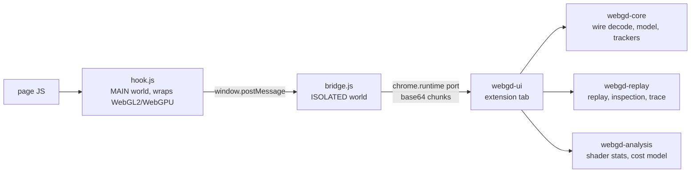

# webgd

webgd is a frame debugger for web pages that render with WebGL2 or WebGPU. It runs inside the same Chrome instance as the target page. A Chrome MV3 extension records every graphics API call made during one `requestAnimationFrame` frame, along with the GPU resource contents at the start of that frame. A Rust/WASM UI built on egui then replays the frame on its own device, so you can inspect the state at any command, browse resources and look at a GPU timeline. Apart from three small extension scripts, all of it is written in Rust.

## Features

- **Frame capture.** Records every WebGL2/WebGPU call in one rAF frame. Pre-frame state comes from a snapshot taken at the start of that frame.
- **Page overlay.** On pages with a WebGL2 context or a `GPUDevice`, a small top-right overlay shows `Webgd capturable`, `FPS <n>` (1 s window) and `Frame <n>` (rAF frames since install), with ` capturing…` appended while a capture runs. WebGL1-only pages show `Webgd: WebGL1 not supported`. The overlay lives in a closed shadow root, ignores pointer events, updates at most 4 times a second and is not recorded in captures.
- **Workspaces.** A top menu bar holds File (Open .webgd…, Save .webgd; Ctrl/Cmd+O), Capture (Refresh targets, Show Capture panel, one Capture entry per live target) and Window (focus any tab), plus a switch between the **Frame Debugger** and **GPU Trace** workspaces, each with its own dock layout. A bottom status bar shows the source URL, the current position, replay status and an error count that opens the Log.
- **Events and Scrubber.** The **Events** panel lists calls grouped by render/compute passes, debug groups and page markers, with `#`, a kind color strip, the event label and GPU duration after a trace. It offers `Actions only`, Collapse/Expand all, a text filter and a selectable `Pre-frame setup (N calls)` group. The **Scrubber** shows the frame's actions as a horizontal strip (widths follow GPU duration after a trace) with marker bands; click or drag to select, Left/Right to step, Home/End for first/last event.
- **Distinct event colours.** Each action gets its own colour (golden-angle hue per action ordinal), shared by its **Scrubber** block and its GPU Trace **Items** bar. A 3 px strip shows the event kind, 1 px separators split neighbouring blocks, and labels switch between dark and light text for contrast.
- **Inspection.** Selecting a command replays the frame up to that command on webgd's own device. **Render Targets** shows a thumbnail strip and a large preview (Fit / 1:1, texel readout, Open in Resource Viewer). The **API Inspector** walks the pipeline stage by stage (Input Assembly, Vertex Shader, Rasterizer, Fragment Shader, Depth/Stencil, Color Output, or Compute Shader / Dispatch, plus All state) with links to the bound resources.
- **Geometry.** The **Geometry** tab (Frame Debugger centre group) shows the selected draw's vertices in 3D: a `Pre-VS` / `Post-VS` toggle (Post-VS is disabled with a tooltip giving the reason when unavailable), `Wireframe` / `Solid` / `Points`, a position source combo, a `Clip space (no divide)` option, an instance selector and `Reset view`. Drag orbits, pans and zooms; double-click fits; Post-VS draws the NDC clip box. Below it, a vertex table is grouped by layout slot (`Slot n · stride s · per-vertex|per-instance · Buffer#id`, with IDX/VTX and `@location name format` columns); Post-VS shows `Vertex shader outputs · instance n`. WebGPU post-VS data comes from running the vertex entry point as a compute shader; WebGL2 uses transform feedback.
- **Resource browser.** **Resources** lists every buffer, texture, shader, program, pipeline, sampler, bind group and so on, with origin, revision count and last write (`Written in frame` narrows the list; double-click selects the last write). The **Resource Viewer** shows:
  - textures: mip/layer selection, channel toggles, a value range with `Auto`, zoom/pan and a texel readout
  - buffers: hex, u8, u16, u32, i32, f32 or f16
  - shaders: source plus estimated per-stage statistics
  - programs and descriptor trees
  - a yellow banner on resources whose contents could not be captured
  - a **Revisions** side panel listing every create/write/read/destroy of the resource in the pre-frame and frame sections. Clicking a revision selects that command (pre-frame rows show the contents at frame start), and ← / → jump between writes.
- **GPU trace.** A timeline with collapsible queue groups (passes, markers, items) and a counters group: Occupancy, ALU, Branches and Texture samples (all marked "(est.)"), and Fragments. Ctrl+wheel zooms, drag pans, `F` fits the view, and a crosshair reads out the time. Drag the ruler or shift+drag to select a range (Esc clears; Zoom to range / Clear range); the range summary shows duration, item count, per-counter average/total and the top 10 items. Clicking a bar selects its command.
- **Save/Open `.webgd`.** A `.webgd` file holds the raw capture bytes. Saved captures open in standalone mode without the extension.
- **Page-side markers.** Pages can call `window.__webgd.pushMarker(name)`, `popMarker()` and `insertMarker(name)` to annotate WebGL2 frames.

## How it works



`hook.js` patches the WebGL2/WebGPU prototypes at `document_start` and encodes the captured frame in the wire format. `bridge.js` forwards those bytes to the UI tab over a `chrome.runtime` port. The UI decodes them with `webgd-core`. It then replays the calls through `webgd-replay` on fresh WebGL2 contexts and GPU devices, and computes estimated counters with `webgd-analysis`. For details, see [docs/architecture.md](docs/architecture.md) and [docs/wire-format.md](docs/wire-format.md).

## Quick start

### Prerequisites

- Rust 1.99+ (edition 2024)
- `rustup target add wasm32-unknown-unknown`
- `cargo install wasm-bindgen-cli --version 0.2.130 --locked`. This must match the pinned `wasm-bindgen` crate; `cargo xtask build` checks it.
- Node.js, needed only to regenerate the wire fixture
- Chrome 121 or newer

### Build

```sh
cargo xtask build            # or: cargo xtask build --release
```

This writes `index.html`, `main.js`, `webgd_ui.js` and `webgd_ui_bg.wasm` into `extension/ui/`.

### Load the extension

1. Open `chrome://extensions` and enable Developer mode.
2. Click **Load unpacked** and select the `extension/` directory.
3. Reload any page that was already open before the extension was installed.

Branded Chrome ignores `--load-extension`. For automated setups, load the extension through CDP `Extensions.loadUnpacked` and start Chrome with `--enable-unsafe-extension-debugging`.

### Capture a fixture page

```sh
python3 -m http.server 8000 --directory tests/pages
```

1. Open `http://localhost:8000/webgpu.html` or `http://localhost:8000/webgl2.html` in a visible tab.
   The page shows a top-right `Webgd capturable` overlay with FPS and frame counters once it has a WebGL2 context or `GPUDevice`. No overlay means the extension is not hooked in (reload the page); `Webgd: WebGL1 not supported` means the page can't be captured.
2. Click the webgd toolbar action. The webgd UI opens in a new tab.
3. Open the **Capture** menu and pick the target's entry (or use **Capture** in the Capture panel).
4. Select an event in **Events** or the **Scrubber** to see it in **Render Targets** and the **API Inspector**. Browse resources in **Resources** and their history in the **Resource Viewer**, or switch to the **GPU Trace** workspace and click **Run trace**.

[docs/user-guide.md](docs/user-guide.md) covers each panel.

## Standalone mode

The built UI can run without the extension to view saved captures:

```sh
python3 -m http.server 8080 --directory extension/ui
```

Open `http://localhost:8080` and use **Open .webgd…**. Live capture is disabled, and the Capture tab shows `standalone mode: live capture unavailable`.

## Repository layout

| Path | Contents |
| --- | --- |
| `crates/webgd-core` | Capture model, wire decoder (`wire.rs`), call labels (`display.rs`), pixel decoding (`pixels.rs`), state trackers (`track/`). Native-testable. |
| `crates/webgd-analysis` | WGSL (naga) and GLSL (glsl-lang) static analysis; cost model in `model.rs`. Native-testable. |
| `crates/webgd-replay` | WASM only. Replay engine (`engine.rs`), JS helpers, snapshot application, GL/GPU inspection (`gl/`, `gpu/`), trace runner (`trace.rs`). |
| `crates/webgd-ui` | WASM cdylib. eframe 0.36 + egui_dock 0.21 app on the wgpu backend: extension port client (`port.rs`), replay scheduling (`replay_queue.rs`), panels (`panels/`). |
| `xtask` | `cargo xtask build [--release]`: builds the UI to WASM, runs wasm-bindgen, copies the host page. |
| `extension/` | `manifest.json`, `hook.js`, `bridge.js`, `background.js`. `extension/ui/` is build output and is gitignored. |
| `web/` | UI host page templates (`index.html`, `main.js`), copied into `extension/ui/` at build time. |
| `tests/pages/` | Fixture target pages: `webgl2.html`, `webgpu.html`, `common.js`. |
| `tests/fixtures/sample.wire` | Wire-format fixture produced by `tools/gen-wire-fixture.cjs`. |
| `tools/gen-wire-fixture.cjs` | Generates the fixture with the same `WireWriter` that `hook.js` uses. |

## Testing

```sh
cargo test                                                          # native crates (webgd-core, webgd-analysis, xtask)
cargo clippy -p webgd-replay -p webgd-ui --target wasm32-unknown-unknown
node tools/gen-wire-fixture.cjs && git diff --exit-code tests/fixtures/sample.wire
cargo xtask build
```

The fixture check confirms that the JS encoder in `hook.js` and the Rust decoder still agree byte for byte. [docs/development.md](docs/development.md) describes the full workflow.

## Known limitations

- Counters are estimates from a static cost model. Timings are measured on webgd's replay device, not on the page's own submission.
- Chrome quantizes WebGPU timestamps (about 65 µs) unless `chrome://flags/#enable-webgpu-developer-features` is enabled.
- WebGPU occlusion results in Chrome are 0/1 visibility flags, so `Fragments (post-depth)` is 0 or 1.
- `depth24plus` textures cannot be viewed. Pre-frame depth/stencil and MSAA contents are not captured; such resources show a banner.
- WebGL1 is detected but not supported. Workers and OffscreenCanvas in workers are not supported.
- Geometry: `executeBundles` and multi-draw calls are not supported, and WebGL2 draws with a base instance other than 0 are not supported. Failures show up as the Post-VS disabled reason.
- Capture needs a visible tab driven by `requestAnimationFrame`. Otherwise it fails with `target does not render with requestAnimationFrame`.

[docs/user-guide.md](docs/user-guide.md) has the full list.

## Documentation

- [docs/architecture.md](docs/architecture.md): components, data flow, replay design
- [docs/wire-format.md](docs/wire-format.md): capture byte format (`.webgd` files)
- [docs/user-guide.md](docs/user-guide.md): installing, capturing, panels, limitations
- [docs/development.md](docs/development.md): toolchain, building, testing, fixtures
- [docs/index.html](docs/index.html): project report

## License

MIT. See [LICENSE](LICENSE).
