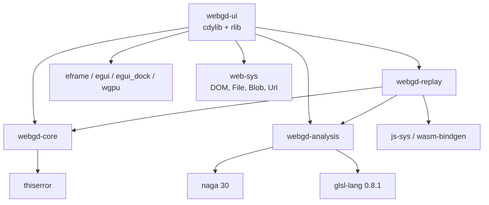
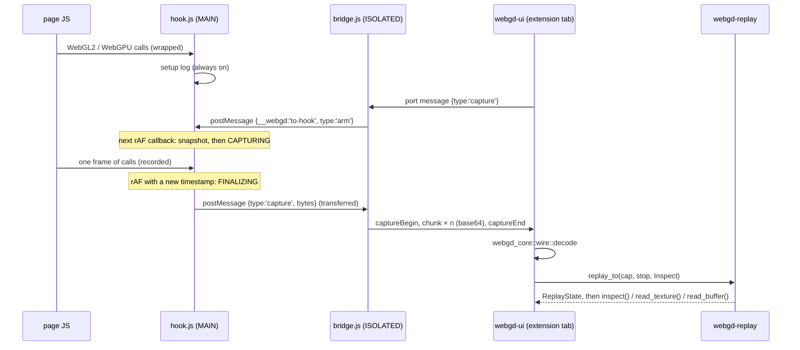

# webgd architecture

webgd captures one frame of a WebGL2 or WebGPU page and replays it inside the webgd tab on
its own GPU contexts. The page-facing part is a Chrome MV3 extension of three plain JS files.
Everything else, from decoding to replay, inspection, analysis and UI, is Rust compiled to
WebAssembly.

Related documents:

- [wire-format.md](wire-format.md): the byte layout of a capture and every `webgd:*` record.
- [user-guide.md](user-guide.md): how to install, capture and use the panels.
- [development.md](development.md): toolchain, build and test commands.

## Components

| Path | Runs in | Role |
| --- | --- | --- |
| `extension/manifest.json` | Chrome | MV3 manifest. Injects `hook.js` into the MAIN world and `bridge.js` into the ISOLATED world at `document_start`, in all frames. Extension pages get CSP `script-src 'self' 'wasm-unsafe-eval'`. |
| `extension/hook.js` | page, MAIN world | Wraps WebGL2/WebGPU prototypes, keeps the setup log, takes the frame-start snapshot, encodes the capture with `WireWriter`. |
| `extension/bridge.js` | page, ISOLATED world | Relays between `window.postMessage` (hook) and the `chrome.runtime` port `webgd-target` (UI). Splits captures into base64 chunks. |
| `extension/background.js` | service worker | Opens `ui/index.html` in a new tab when the toolbar action is clicked. |
| `web/index.html`, `web/main.js` | webgd tab | Host page: a `<canvas id="webgd_canvas">` and a module script that calls the wasm-bindgen `init()`. `cargo xtask build` copies both into `extension/ui/`. |
| `crates/webgd-core` | native + wasm | Capture model (`capture.rs`), wire decoder (`wire.rs`), call labels (`display.rs`), pixel decoding (`pixels.rs`), pure trackers (`track/commands.rs`, `track/gl.rs`, `track/gpu.rs`, `track/resources.rs`). |
| `crates/webgd-analysis` | native + wasm | Static shader analysis: WGSL through naga (`wgsl.rs`), GLSL ES through glsl-lang (`glsl.rs`). Every counter constant and formula lives in `model.rs`. |
| `crates/webgd-replay` | wasm only | Replay engine (`engine.rs`), JS access helpers (`js.rs`), `Value` to `JsValue` conversion (`value.rs`), GL snapshot restore, formats, uniforms and inspection (`gl/`), GPU snapshot restore and inspection (`gpu/`), trace runner (`trace.rs`). |
| `crates/webgd-ui` | wasm only (cdylib) | eframe 0.36 app with an egui_dock layout on the wgpu renderer. Port client (`port.rs`), replay scheduling (`replay_queue.rs`), file open/save (`files.rs`), panels (`panels/`). |
| `xtask` | native | `cargo xtask build [--release]`. Checks `wasm-bindgen --version` for `0.2.130`, builds `webgd-ui` for `wasm32-unknown-unknown`, runs `wasm-bindgen --target web --no-typescript --out-dir extension/ui --out-name webgd_ui`, copies the `web/` files. |

### Crate dependency graph

The workspace sets `default-members` to `webgd-core`, `webgd-analysis` and `xtask`. A plain
`cargo test` therefore builds only native code. `webgd-replay` and `webgd-ui` are gated with
`#![cfg(target_arch = "wasm32")]` and are only built for the wasm target. `webgd-replay` has no
`web-sys` dependency.

## End-to-end data flow

## Capture: `extension/hook.js`

`hook.js` is a single classic-script IIFE. In a browser it installs once per window, guarded by
`Symbol.for('webgd.hook')`. Under Node it only exports `{ WireWriter }`, which
`tools/gen-wire-fixture.cjs` uses to produce `tests/fixtures/sample.wire`.

### Object ids

A `WeakMap` gives every object seen by the hook a dense id starting at 1. Each new id appends
`{id, cls: constructor.name, parent}` to `objectTable`, which is never pruned. The parent is the
`this` of the call that returned the object. For example, a `GPUTextureView` has its `GPUTexture`
as parent and a `WebGLBuffer` has its context. `navigator.gpu` gets an id at install time.

### Wrapping

`wrapProto` replaces every own function property except `constructor` on
`WebGL2RenderingContext` and on `GPU`, `GPUAdapter`, `GPUDevice`, `GPUQueue`, `GPUBuffer`,
`GPUTexture`, `GPUCommandEncoder`, `GPURenderPassEncoder`, `GPUComputePassEncoder`,
`GPURenderBundleEncoder`, `GPUCanvasContext`, `GPUShaderModule`, `GPURenderPipeline`,
`GPUComputePipeline` and `GPUQuerySet`. The original functions are stored in `ORIG` under
`'Class.method'`. The hook's own snapshot and readback code calls only `ORIG` functions, so that
work is never recorded. Prototypes of WebGL extension objects returned by `getExtension` are
wrapped lazily, once per prototype.

Accessors are wrapped separately:

- The `GPUDevice.prototype.queue` getter records `get:queue` once per device.
- The `label` setter on every `GPU*` prototype records `set:label`.
- The `width`/`height` setters of `HTMLCanvasElement` and `OffscreenCanvas` record `set:width`/`set:height`, for canvases that already have an id.
- `getContext` on both canvas classes records `getContext` for `webgl2` and `webgpu`. `webgl` and `experimental-webgl` contexts get an id and increase the `webgl1` status count, but their methods are never wrapped.

In the idle state a wrapper calls straight through unless its method is tracked by the setup log
or needs bookkeeping (`bindBuffer`, `bindTexture`, `mapAsync`, `getMappedRange`,
`GPUCommandEncoder.finish`, GL texture uploads). While capturing, the wrapper converts the
arguments *before* calling the original, so typed arrays are copied before the page can reuse
them. It then converts the result and pushes a record. If the result is a promise, the record
holds `Pending(token)`, and a `webgd:resolved` record is added when the promise settles. The
page always receives the original promise.

WebGPU usage is augmented on the real call, and replay applies the same rules:

- `createBuffer`: `COPY_SRC` is added unless the buffer is `MAP_READ`.
- `createTexture`: `COPY_SRC` is added when `sampleCount` is 1 and the usage has no `TRANSIENT_ATTACHMENT` bit.
- `GPUCanvasContext.configure`: `COPY_SRC` is added.

The capture keeps the descriptor as the page wrote it.

### Setup log and pruning

The setup log is always on. It records every call needed to rebuild the objects that exist when
a capture starts:

- WebGL2: `create*` and `delete*`, plus `shaderSource`, `compileShader`, `attachShader`, `detachShader`, `bindAttribLocation`, `transformFeedbackVaryings`, `linkProgram`, `getUniformLocation` and `getExtension`.
- WebGPU: `GPU.requestAdapter`, `GPUAdapter.requestDevice`, every `GPUDevice.create*`, `GPUCanvasContext.configure`/`unconfigure`/`getCurrentTexture`, `GPUTexture.createView`/`destroy`, `GPUBuffer.destroy`/`unmap`, `GPUQuerySet.destroy`, `getBindGroupLayout` on pipelines, and every `GPURenderBundleEncoder` call.
- Both APIs: `getContext`, `get:queue`, `set:label`, `set:width`, `set:height`, and `webgd:resolved` for promises issued by logged calls.

Each entry holds a `WeakRef` to the object it is about, or no ref.

`prune()` is a mark-sweep. It runs each time the log has grown by `PRUNE_EVERY = 5000` entries
since the last prune, and again at every snapshot.

- **Roots** are entries without a ref, plus entries whose referent is still alive and not destroyed. A destroyed `GPUBuffer`, `GPUTexture` or `GPUQuerySet`, a finished encoder, and an expired canvas texture count as destroyed, as does a texture view whose texture is destroyed. Deleted WebGL objects that are still alive stay roots, because GL keeps them alive while they are attached to containers.
- **Marking** a kept entry also keeps:
  - the creation entry of its `this`
  - the creation entries of all ObjRefs in its args
  - for `webgd:resolved`, the entry that issued the token
  - every entry whose subject is the object it created

Texture uploads normally go to the snapshot, not the log. The exception is the *shadow class*:
textures whose contents `readPixels` cannot read back. This covers `LUMINANCE`, `ALPHA`,
`LUMINANCE_ALPHA`, `RGB9_E5`, the `*_SNORM` formats, `RGB16F`, `RGB32F`, `SRGB8`, the
`RGB*I`/`RGB*UI` formats, and anything defined through `compressedTex*`. For these textures,
each `texImage*`, `texSubImage*`, `compressedTex*` and `texStorage*` call is logged with its
data. It is preceded by `webgd:bindForUpload` and `webgd:pixelStore` records.

- Redefining a level removes that level's earlier upload entries.
- `deleteTexture` removes all of the texture's upload entries.
- Uploads from a bound `PIXEL_UNPACK_BUFFER`, and `copyTex*` into a shadow texture, mark the texture uncapturable.

### Frame boundary and snapshot

The hook wraps `window.requestAnimationFrame`. On an `arm` message the mode becomes `ARMED`, and
a 2000 ms timer is started. If no rAF callback runs before the timer fires, the hook reports
`target does not render with requestAnimationFrame`.

The first rAF callback after arming calls `runSnapshot()`:

1. Prune the setup log, then copy it. The copy becomes the setup section.
2. Run `snapshotGL` for every live WebGL2 context. It reads state with `ORIG` calls, using a scratch FBO and VAO that never get ids, and restores every binding it touched.
3. Run `snapshotGPU`. For each live `GPUBuffer` and `GPUTexture`, it encodes a copy into a fresh `MAP_READ` staging buffer, submits it, and queues `mapAsync`. Copies run in queue order, so the data is the pre-frame contents.
4. Emit `webgd:canvasSize` for every canvas that has an id.

The record schemas are listed in [wire-format.md](wire-format.md#snapshot-records). GL errors
that the page has not yet read are drained before the snapshot. The wrapped `getError` returns
them to the page afterwards.

The mode then becomes `CAPTURING`, and `captureTs` is set to the rAF timestamp. Every wrapped
call is recorded into the frame section, as are `window.__webgd.pushMarker/popMarker/insertMarker`.
On an unmap of a buffer mapped for writing, the hook first emits `webgd:mappedWrite` with the
bytes of each `getMappedRange` range.

The first rAF callback with a different timestamp switches to `FINALIZING`. `finalize()` waits up
to 10 s for the snapshot readbacks. It then encodes `objectTable`, the setup copy, the snapshot
records and the frame records with `WireWriter`. Finally it posts the bytes to the bridge as a
transferred `Uint8Array` and returns to `IDLE`.

## Transport: `bridge.js` and `port.rs`

Hook and bridge exchange `window.postMessage` messages keyed by `__webgd`. Each side ignores
events whose `source` is not its own window.

| Direction | Message |
| --- | --- |
| hook → bridge | `{__webgd:'to-bridge', type:'status', gl2, webgl1, gpuDevices}` |
| hook → bridge | `{__webgd:'to-bridge', type:'capture', bytes}` |
| hook → bridge | `{__webgd:'to-bridge', type:'captureError', message}` |
| bridge → hook | `{__webgd:'to-hook', type:'arm'}` |

The bridge connects with `chrome.runtime.connect({name: 'webgd-target'})` once the DOM exists. It
sends `hello` (`url`, `title`, `isFrame`, `status`) followed by `status`. The port drops when no UI
is listening. When a `webgd-ui-hello` runtime message arrives, the bridge reconnects.

Extension messaging serializes to JSON, so the bridge sends captures as base64:

1. `{type:'captureBegin', total}`
2. `{type:'chunk', index, b64}` for each slice of `CHUNK_BYTES = 4 MiB`. Each slice is built with `btoa` over 32 KiB sub-chunks.
3. `{type:'captureEnd'}`

On the UI side, `port.rs` decides the mode at startup. If `chrome.runtime.id` is missing, the UI
runs in standalone mode and only file open/save is available. Otherwise `port.rs`:

- listens on `chrome.runtime.onConnect` for ports named `webgd-target`
- broadcasts `{type:'webgd-ui-hello'}` to every tab with `chrome.tabs.sendMessage`
- removes a target when its port disconnects

Chunks must arrive in index order. They are decoded with the `base64` crate into one `Vec<u8>`.
On `captureEnd`, the byte count must equal `total`, and the bytes go to the inbox. `state.rs`
decodes them with `webgd_core::wire::decode`. Captures opened from a `.webgd` file go through
the same inbox. `Save .webgd` writes the raw wire bytes as `capture-<unix-ms>.webgd`.

## Replay: `webgd-replay`

`webgd-replay` accesses WebGL2 and WebGPU only through the helpers in `src/js.rs`: `get`, `set`,
`call`, `construct` and `await_promise`, built on `js_sys::Reflect` and `Function::apply`.
`value.rs` converts capture values:

- `ObjRef` becomes the mapped replay object. An unmapped id is a `ReplayError::Unmapped` error.
- `Typed` becomes a fresh typed array over a copy of the blob.
- `Image` becomes `ImageData`.
- `Dict` and `Array` become a JS object and a JS array.
- `Pending` and `Opaque` become `undefined`.

`ObjMap` holds `fwd: HashMap<ObjId, JsValue>` and a reverse `js_sys::Map`. Inspection uses the
reverse map to turn live objects back into capture ids.

### Replay order

`Replayer::replay_to(cap, stop, mode)` builds a new `Engine` each time. Every replay uses new
OffscreenCanvases, GL contexts and devices.

1. Map `GPU` objects to `navigator.gpu`, and seed canvas sizes from `webgd:canvasSize`.
2. **Setup**: execute every setup record in order.
3. **Snapshot**: apply `webgd:canvasSize`, then the GL records per context (`gl/snapshot.rs`), then `webgd:gpuBuffer`/`webgd:gpuTexture` (`gpu/snapshot.rs`). Finally, unmap buffers left mapped from a setup `mappedAtCreation`.
4. **Frame**: execute `frame[0..=stop]`.
5. **WebGPU termination**:
   - pop any debug groups still open
   - `end()` every pass still open
   - `finish()` every command encoder created in the frame and not finished, in creation order
   - `queue.submit` the command buffers on their own devices
6. Wait for `onSubmittedWorkDone` on each device, so pending `uncapturederror` events are delivered.

Every exception is recorded in `ReplayState::errors` and replay continues. Errors in the frame
carry their frame index. Setup and snapshot errors use `usize::MAX`, with a `setup: ` or
`snapshot: ` prefix. GL errors are polled with `getError` after the setup, snapshot and frame
sections, and reported once per section. Promise results are awaited immediately, with a 10 s
timeout.

### Special cases

`Engine::dispatch` matches on the method name, and then on `(class, method)`. Calls that match
no rule go through a generic `call(this, method, args)`, and an `ObjRef` result is mapped.

| Call | Replay behavior |
| --- | --- |
| `webgd:resolved` | Maps the ObjRef to the value stored under its token. |
| `webgd:pushMarker` / `popMarker` / `insertMarker` | Ignored by replay. Used by the command tree and the trace. |
| `webgd:canvasSize`, `set:width`, `set:height` | Resize the replay OffscreenCanvas (default 300×150). The cached WebGPU canvas texture is dropped. |
| `get:queue` | Maps the queue id to `device.queue`. |
| `set:label` | `label` is set on the replay object. |
| `webgd:mappedWrite` | Copies the bytes into the range `getMappedRange` returned for `(buffer, offset)`. |
| `webgd:bindForUpload` | `activeTexture` on the scratch unit, then `bindTexture`. Cube face targets map to `TEXTURE_CUBE_MAP`. |
| `webgd:pixelStore` | Calls `pixelStorei` for each key, using the decimal pname. |
| `getContext('webgl2', attrs)` | Calls `getContext` on a new `OffscreenCanvas` with `preserveDrawingBuffer: true`. `GlCtx::new` enables `EXT_color_buffer_float` and `EXT_float_blend`, looks up `EXT_disjoint_timer_query_webgl2`, and creates a scratch FBO and VAO. The scratch texture unit is `MAX_COMBINED_TEXTURE_IMAGE_UNITS - 1`. |
| `getContext('webgpu')` | Maps the context to a plain JS stub (`GpuCanvasCtx`). |
| `getContext('webgl')` | Error: WebGL1 is unsupported. |
| `GPU.requestAdapter` | Calls `navigator.gpu.requestAdapter` again, so each replayed request gets a fresh adapter. If no adapter is returned, the error is `WebGPU unavailable in webgd tab`. |
| `GPUAdapter.requestDevice` | Drops required features that the adapter lacks, reporting `missing feature X` for each. Adds `timestamp-query` when the adapter supports it. Clamps `requiredLimits` to the adapter limits (`min*` limits are raised, others lowered). Registers an `uncapturederror` listener. |
| `createBuffer` / `createTexture` | Apply the hook's usage augmentation. Also add `COPY_DST` to buffers that are neither `MAP_READ` nor `MAP_WRITE`, and to textures with `sampleCount` 1, so snapshot contents can be written. |
| `GPUCanvasContext.configure` / `unconfigure` / `getConfiguration` | Store or clear the configuration on the stub. |
| `GPUCanvasContext.getCurrentTexture` | Returns a texture created by webgd with the canvas size, the configured format, configured usage plus `RENDER_ATTACHMENT`, `COPY_SRC`, `COPY_DST` and `TEXTURE_BINDING`, and label `webgd:canvas`. The frame section gets one new texture. |
| `getMappedRange` | The returned `ArrayBuffer` is stored under `(buffer, offset)`. |
| `importExternalTexture({source: Image})` | The image becomes a `VideoFrame` (`format: 'RGBA'`). It is closed on `dispose()`. |

`ReplayState::dispose()` releases the replay resources:

- removes the `uncapturederror` listeners
- calls `destroy()` on every replay device
- loses every GL context through `WEBGL_lose_context`
- closes any `VideoFrame`s it created

### Snapshot application

`gl/snapshot.rs` applies the records of one context in this order:

1. **Neutral transfer state.** Pixel-store defaults, unbind the unpack/pack buffers and the VAO, disable `SCISSOR_TEST` and `RASTERIZER_DISCARD`.
2. **Textures** (`webgd:glTexture`).
   - Allocate storage. Immutable textures use `texStorage2D`/`texStorage3D` with `immutableLevels`. Other textures use `texImage2D`/`texImage3D` with a null source per level and face. If `format`/`type` were not recorded (copy, compressed or storage definitions), `formats.rs::canonical_format_type` supplies them.
   - Apply `params`.
   - Restore each level that has data with `GlCtx::blit_upload`. The data is uploaded into a temporary texture of the read class (`RGBA8`, `SRGB8_ALPHA8`, `RGBA32F`, `RGBA32I` or `RGBA32UI`), attached to `READ_FRAMEBUFFER`, and blitted with `NEAREST` into the target level, face or layer through the scratch FBO.
   - Skip levels noted `uploadLog`: setup already replayed their uploads.
   - Levels without data get a note `pre-frame contents not captured (depth/stencil)` or `(not readable)`.
3. **Buffers** (`webgd:glBuffer`): `bufferData` with the data, or with the size when there is no data. Index buffers are bound through the scratch VAO.
4. **Renderbuffers** (`webgd:glRenderbuffer`): `renderbufferStorageMultisample`, then a color blit when data is present.
5. **Framebuffers** (`webgd:glFramebuffer`): reattach the attachments, then `drawBuffers` and `readBuffer`.
6. **Samplers** (`webgd:glSampler`): `samplerParameteri`, or `samplerParameterf` for the LOD pnames.
7. **Vertex arrays** (`webgd:glVertexArray`).
8. **Programs** (`webgd:glProgram`): uniforms are set through the type table in `gl/uniforms.rs`, then `uniformBlockBinding`.
9. **Default framebuffer** (`webgd:glDefaultFramebuffer`). With data, it is blitted into the default framebuffer. Without data, the context gets a note `pre-frame default framebuffer contents not captured (preserveDrawingBuffer is false)`.
10. **Global state last** (`webgd:glState`). Caps, blend/depth/stencil/raster state, pixel store, current vertex attribs, per-unit texture and sampler bindings, UBO ranges, buffer, framebuffer and VAO bindings, the program, and the active texture.

Global state goes last because every earlier step changes bindings.

`gpu/snapshot.rs` handles `webgd:gpuBuffer` and `webgd:gpuTexture`:

- **Buffers.**
  - A buffer still mapped from `mappedAtCreation` is written through `getMappedRange` and then unmapped.
  - Otherwise, `queue.writeBuffer` writes the 4-byte-aligned prefix, if the buffer has `COPY_DST`.
  - Mappable buffers without `COPY_DST` get a `pre-frame contents not restored (mappable buffer)` note.
- **Textures.** Each subresource is written with `queue.writeTexture`, using the recorded `bytesPerRow`/`rowsPerImage`.
- **Null data.** The resource gets the note `pre-frame contents not captured (<note>)`.

### Inspection

`ReplayState::inspect(cap, index)` uses GL inspection (`gl/inspect.rs`) when `frame[index]` or the
nearest earlier call targets a WebGL2 context. When `frame[index]` is a `GPU*` call, it uses GPU
inspection (`gpu/inspect.rs`). If neither applies and the capture has exactly one GL context and no
devices, GL inspection is used.

- **GL.**
  - **Targets**: color attachments of the current draw framebuffer (per `DRAW_BUFFERi`), read back by format class, or the default framebuffer as RGBA8. Depth and stencil are reported as `depth/stencil not readable in WebGL2`.
  - **Pipeline**: groups `Program`, `Rasterizer`, `Depth`, `Stencil`, `Blend`, `ColorMask`, `Viewport/Scissor`, `Multisample` and `DrawBuffers`. Enum values are named by `gl::enum_name`, which enumerates `WebGL2RenderingContext.prototype` constants (first name wins).
  - **Bindings**: `Attributes`, `Index buffer`, uniforms, uniform blocks and texture units. Objects resolve to capture ids through the reverse map.
- **GPU.** `webgd_core::track::gpu::state_at(cap, index)` tracks the pass that is `this` of `frame[index]`, or else the most recently begun pass that is still open.
  - **Targets**: the color and depth attachment views, resolved to their textures through `ObjectInfo.parent`.
  - **Pipeline**: the pipeline's creation descriptor rendered as a tree, followed by a `Dynamic` group (viewport, scissor, blend constant, stencil reference).
  - **Bindings**: bind group entries (with layout detail, or `auto layout` for `getBindGroupLayout` layouts), vertex buffers and the `Index buffer`.
  - Selecting a call on a `GPURenderBundleEncoder` gives the note `bundle recording — select executeBundles`.

Readback works at the replayed point:

- `read_texture`:
  - GPU textures: `copyTextureToBuffer` with 256-byte row alignment into a `MAP_READ` staging buffer (label `webgd:readback`), then rows are de-padded. Formats that `pixels::gpu_format` does not know return `format not viewable (<format>)`.
  - GL textures and renderbuffers: read through the scratch FBO, sized by `webgd_core::track::gl::texture_dims`.
- `read_buffer`: `copyBufferToBuffer` for GPU buffers, `getBufferSubData` for GL buffers.

### Replay scheduling: `ReplayQueue`

`webgd-ui/src/replay_queue.rs` keeps one pending request, `Option<Request>`. Each new request
overwrites the previous one (latest wins). `App::schedule_replay` submits a `Key {generation,
stop}`, the selected command, and the viewer's read request. Identical consecutive submissions
are ignored.

A single `spawn_local` loop processes requests:

1. Take the pending request.
2. Reuse the held `ReplayState` if its key matches. Otherwise `dispose()` it and `replay_to(..., ReplayMode::Inspect)`.
3. Run `inspect(index)`, unless a newer request with a different key is already pending.
4. Run the view read (`read_texture`, `read_buffer`, shader info log, program info), with the same check.
5. Keep the state for the next request.

The loop runs while requests are pending. The `Replayer` is created once per UI session.

## GPU trace: `webgd-replay/src/trace.rs`

`run_trace` performs `TRACE_RUNS = 5` instrumented replays to the last command
(`ReplayMode::Trace(TraceInstr::Timed)`). A run that reports `GPU_DISJOINT_EXT` is repeated, at
most `GL_DISJOINT_RETRIES = 3` times. Of the five runs, the one with the median total GPU time is
kept whole, so all spans come from one consistent layout. If the frame contains any WebGL draw,
one more untimed run (`TraceInstr::GlFragmentCount`) counts fragments.

**Items** are the `Draw`, `Dispatch` and `Clear` command kinds from
`webgd_core::track::commands`, excluding calls recorded into render bundles. There is one queue
track per replay `GPUDevice` (`Queue (GPUDevice#id)`) and one per GL context
(`GL context #id`).

### WebGPU timing

Timing needs `timestamp-query` on the replay device. Without it, the run adds the note
`timestamp-query unsupported: WebGPU items use a nominal layout`, and items are laid out 1 µs
apart.

**Pass splitting.** `beginRenderPass`/`beginComputePass` are not forwarded. The descriptor is
stored instead.

- State calls are kept as the latest call per key and are not forwarded. The keys are `setPipeline`, `setIndexBuffer`, `setViewport`, `setScissorRect`, `setBlendConstant`, `setStencilReference`, and `setBindGroup`/`setVertexBuffer` per index.
- Debug group calls inside the pass are dropped. The marker rows are built from the capture instead.
- Each `draw*` or `dispatch*` opens its own segment pass (`segment_desc`):
  - The first segment uses the recorded load ops. Later segments use `load` for every aspect the descriptor had.
  - Store ops are always `store`.
  - The recorded `timestampWrites`/`occlusionQuerySet` are replaced with webgd's own.
- Inside the segment, webgd replays the kept state calls, then runs `beginOcclusionQuery` (draws only), the item, `endOcclusionQuery` and `end()`.
- A pass with no items runs one empty segment.
- Indirect items copy 4 (`drawIndirect`), 5 (`drawIndexedIndirect`) or 3 (`dispatchWorkgroupsIndirect`) u32 words of arguments into a staging buffer.
- Any other call inside a split pass is an error.

**Unsplit passes.** A pass is not split if:

- its descriptor has `occlusionQuerySet` or `timestampWrites`, or
- it calls `beginOcclusionQuery`, `executeBundles` or `writeTimestamp`.

Such a pass runs whole, with pass-level timestamps. Its items share the pass span and are
labelled `(unsplit pass)`.

**Query layout.**

- Timestamps: each slot `s` uses set `s / 2048`, queries `2(s % 2048)` and `+1`, resolved at byte offset `(s % 2048) · 256`.
- Occlusion: query `k` uses set `k / 4096`, resolved at `(k % 4096) · 256`.

Each encoder resolves its own queries just before `finish()`. After the frame,
`trace_collect` copies the resolve buffers to `MAP_READ` staging buffers and reads them.
Timestamps are shifted so that the earliest valid begin is 0.

`Fragments (post-depth)` for a draw is the occlusion result divided by the attachment's sample
count.

### WebGL timing and fragment counting

Each GL item is wrapped in `beginQuery(TIME_ELAPSED_EXT)`/`endQuery`, using
`EXT_disjoint_timer_query_webgl2`. Without the extension, the run adds the note
`EXT_disjoint_timer_query_webgl2 unavailable: GL items have no timing`. Results are polled every
16 ms for up to 5 s. GL items are packed sequentially from 0, and the trace adds the note
`WebGL: sequential layout, no GPU timestamps`. Pass bars are maximal runs of consecutive items
with the same draw framebuffer.

The fragment-count run handles each GL draw as follows:

1. Skip the draw (count 0) if `RASTERIZER_DISCARD` is enabled.
2. Save the affected state.
3. Bind a scratch FBO with an `R16F` texture sized to the current target, and clear it to 0.
4. Switch to a counting program. It links the original vertex shader with a constant `vec4(1.0)` fragment shader, using GLSL ES 3.00 or 1.00 to match the vertex source. Programs are cached per original program.
5. Copy plain uniforms and uniform block bindings from the original program.
6. Enable additive blending (`ONE, ONE`) and disable depth test, stencil test and alpha-to-coverage.
7. Issue the same draw, `readPixels` as float, and sum the red channel.
8. Restore the saved state.

The result is the `Fragments (rasterized, pre-depth)` counter. This run needs
`EXT_color_buffer_float`. Without it, the note is
`float render targets unsupported: no GL fragment counts`.

### Markers

`pushDebugGroup`/`popDebugGroup`/`insertDebugMarker` and
`webgd:pushMarker`/`popMarker`/`insertMarker` are matched per command encoder or GL context.

- A group covers `[min start, max end]` of the items between its push and its pop, at its nesting depth.
- A group without items, and every insert marker, becomes a zero-width span at the start of the next item.
- Groups still open at the end of the frame are closed there.

### Counters and the cost model

For every item span, `counters()` determines the shaders:

- GL: the current program's vertex and fragment sources.
- WebGPU: the `vertex`, `fragment` and `compute` stages of the pipeline's descriptor. For `executeBundles`, the pipeline comes from the bundle's recorded `setPipeline`.

`webgd_analysis::wgsl_stats` and `glsl_stats` return `StageStats` for each stage, cached per
module, entry point and stage. Shaders that fail analysis produce a `shader analysis n/a: …` note.

| Track | Value per item |
| --- | --- |
| `Occupancy (est.)` | `occupancy()` of the fragment stage (else the vertex stage), or of the compute stage for dispatches, in %. |
| `ALU ops/ns (est.)` | Draws: `(vs.alu · vertex invocations + fs.alu · fragments) / duration`. Dispatches: `cs.alu · threads / duration`. |
| `Branches/ns (est.)` | Same formula with `branches`. |
| `Texture samples/ns (est.)` | Same formula with `tex_samples`. |
| `Fragments (post-depth)` | WebGPU occlusion samples divided by sample count. |
| `Fragments (rasterized, pre-depth)` | WebGL fragment-count run. |

Each sample stores both the rate (`value`) and the absolute count (`total`). The counts come
from the call arguments:

- Vertex invocations: count × instances. For indirect draws, the counts come from the indirect readback. For `executeBundles`, they are summed over the bundles' recorded draws.
- Threads: workgroup count × `workgroup_size`.

Chrome may return occlusion results as 0/1 visibility flags. When every WebGPU fragment total is
at most 1, the trace adds a note saying so.

`crates/webgd-analysis/src/model.rs` contains every constant and formula. It describes a
generic, illustrative SIMT machine, not real hardware.

| Item | Model |
| --- | --- |
| Unary, binary, comparison, select, conversion | `W` (result components; matrices count `rows·cols`) |
| Matrix × vector, matrix × matrix | `rows·cols`, `r·c·k` |
| `dot` | `W` (argument width) |
| `cross` | 6 |
| `length`, `distance` | `W + 4` |
| `normalize` | `3W + 4` |
| `sqrt`, `inversesqrt`, `exp`, `exp2`, `log`, `log2`, `pow`, trig and hyperbolic | `4W` |
| `fma` | `W` |
| `mix` | `3W` |
| `clamp` | `2W` |
| `smoothstep` | `6W` |
| Other built-ins | `W` |
| `if` | +1 branch, cost of the more expensive side (the condition is costed by the caller) |
| `switch` | +1 branch, cost of the most expensive case |
| Loop | (iteration + 1 branch for the exit check) × `LOOP_TRIPS = 8` |
| Texture sample/load | +1 `tex_samples` each |
| Registers | `est_regs_vec4 = ceil(components / 4) + 2`, where components = function-local variables of the entry point and its callees, plus entry inputs and outputs |
| Occupancy | `min(16, floor(512 / max(16, regs·4)), lds_waves) / 16`. For compute, `lds_waves = floor(65536 / max(1, workgroup_bytes)) · ceil(threads / 32)`, otherwise 16. |

The WGSL front end parses with `naga::front::wgsl::parse_str`, validates to get expression
types, and sums workgroup variable sizes. If `entry` is `None`, it picks the only entry point of
the requested stage, and reports `AmbiguousEntry` when there are several. The GLSL front end
drops lines whose first non-space character is `#`, parses with glsl-lang, and infers widths
from declarations, constructors, swizzles and built-ins.

The counters are estimates of this model and are always labelled `(est.)`. Durations are
measured on webgd's replay device, not on the page's own submission.

## Design decisions

**JS only where the platform requires it.** The three extension scripts are the only
hand-written JS besides the two-line `web/main.js`.

- `hook.js` must patch prototypes synchronously at `document_start`, before page scripts run. WASM instantiation is asynchronous, and the page's CSP may block WASM.
- `bridge.js` and `background.js` need extension APIs that exist only in their worlds.

Everything that can be tested natively is in pure Rust crates: decoding, trackers, pixel
formats and shader analysis.

**`js_sys::Reflect` instead of web-sys WebGPU/WebGL bindings.** The web-sys WebGPU bindings
require `--cfg web_sys_unstable_apis`, and every type needs its own feature flag. Replay is
driven by recorded method names and argument lists, so a generic `call(obj, name, args)` covers
every API entry point with one code path, including methods the pinned web-sys does not know.
`webgd-replay` therefore depends only on `js-sys` and `wasm-bindgen`. `webgd-ui` uses `web-sys`
only for DOM, file and console access.

**One wire format.** `WireWriter` in `hook.js` is the only encoder and `wire.rs` the only
decoder. A live capture and a saved `.webgd` file are the same bytes. Opening a file and
receiving a live capture take the same inbox path, and standalone mode needs no conversion.
`tests/fixtures/sample.wire` is generated by the JS writer and decoded by Rust tests. This keeps
the two implementations byte-compatible.

**Replay from scratch on webgd's own device.** Each selection replays setup, snapshot and frame
up to the selected command into fresh contexts. This avoids incremental state bugs and allows
stopping in the middle of a pass. The WebGPU termination step makes such partial work visible.
The cost is a full replay per selection change. `ReplayQueue`'s latest-wins policy keeps that
cost bounded during fast navigation.

**Snapshot reads, not page-side history.** Contents that existed before the frame are read back
at frame start instead of being rebuilt from the page's entire upload history. The setup log only
keeps what is needed to recreate objects. The exception is shadow-class texture uploads, which
cannot be read back.

## Known limitations

- Counters are static-model estimates. Timing is measured on the replay device, not on the page's own submission.
- Chrome quantizes WebGPU timestamps (about 65 µs) unless `chrome://flags/#enable-webgpu-developer-features` is enabled.
- WebGPU occlusion results in Chrome are 0/1 visibility flags, so `Fragments (post-depth)` is 0 or 1.
- Passes with render bundles or occlusion queries are timed as a whole.
- Independent WebGPU passes can show overlapping timestamps, because the GPU may run them concurrently.
- Not captured:
  - pre-frame depth/stencil contents (`depth24plus` is also not viewable)
  - pre-frame contents of multisampled textures and renderbuffers
- WebGL1 is detected but unsupported. Workers and OffscreenCanvas in workers are unsupported.
- Capture needs a visible tab driven by `requestAnimationFrame`.
